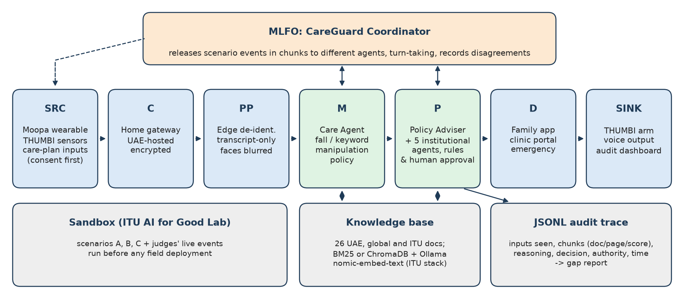

# CareGuard: policy-grounded agents for AI-assisted elderly home care

Team **Moopa** · ITU AI for Good Lab Hackathon, UAE (2026) · healthcare domain, cross-domain with telecom and social care.
Team leader: Adarsh Baburaj (adarshbaburaj8@gmail.com). Repository: https://github.com/adarshbaburaj/moopa_itu

CareGuard sits on top of a home-care deployment (the **Moopa** voice-first wearable, the **THUMBI** low-cost assistive
robot arm and a family/clinic app) and makes it policy-aware. It combines:

1. a **knowledge base** of UAE and global policy, regulatory and standards documents (`kb/`), retrievable with page-level
   source attribution, ingestible with the ITU AI Readiness reference stack (Ollama `nomic-embed-text` + ChromaDB);
2. a **Care Agent** (the ITU sandbox "innovative AI solution" role) that plans tasks and escalations;
3. a **Policy & Legal Adviser** agent that cites applicable law and flags domain-level gaps with global examples;
4. five **institutional agents** (health regulator, data-protection authority, telecom regulator, medical-products
   regulator, social-care authority), each seeing only the slice of a scenario released to it;
5. a **coordinator** (the Y.3172 MLFO role) that releases scenario events in chunks, forwards messages, records
   disagreements and writes a JSONL **audit trace** for every agent turn, then a **gap report**.



## Quick start (no GPU)

```bash
pip install pyyaml pymupdf          # core fallback path
python kb/fetch_docs.py             # download the public documents in kb/manifest.yaml (already committed)
python kb/build_index.py            # parse PDFs/HTML into page-aware chunks -> kb/index/chunks.jsonl
./run_all.sh                        # run scenarios A, B, C and rebuild reports/gap_report.md
```

Run one scenario, or add a live "judges' event":

```bash
python coordinator/run_scenario.py scenarios/B_voice_offshore.yaml
python coordinator/run_scenario.py scenarios/C_consent.yaml \
  --inject "The robot vendor starts using in-home video to train its next model" \
  --inject-to care_agent,data_protection,health_regulator,policy_adviser --inject-facts secondary_use_training \
  --out logs/live
python kb/retriever.py "health data stored or transferred outside the State"   # query the KB directly
```

## With the ITU reference stack (LLM + vector KB)

```bash
pip install chromadb ollama
ollama pull nomic-embed-text && ollama pull qwen2.5:14b     # or: export CAREGUARD_LLM=llama3.1:8b
python kb/ingest_chroma.py --reset                          # ChromaDB collection kb_main, ITU metadata keys
BACKEND=auto RETRIEVER=auto ./run_all.sh
# or ingest the same documents with the unmodified ITU code:
./kb/ingest.sh --itu /path/to/ITUAIReadiness                # runs python -m server.knowledge.ingest --reset
```

With `--backend ollama` the LLM writes each decision from the retrieved chunks only; the coordinator checks that every
chunk the LLM cites was actually retrieved and falls back to the rule base for that turn if not. The committed logs
were produced with the **rules + BM25** fallback; the Ollama and Chroma paths are included but were not run in the
environment that produced these logs.

## Repository layout

```
kb/manifest.yaml          31 documents (UAE, global, ITU) with source URLs; fetch_status.json records what was fetched
kb/InputDocs/{UAE,Global,ITU}/   the 26 public documents that could be downloaded
kb/fetch_docs.py          downloader (official URL first, then listed mirrors; never disables TLS verification)
kb/build_index.py         PDF/HTML -> page-aware chunks (256 words, 30 overlap, as in the ITU reference); OCR fallback
kb/retriever.py           BM25 (pure Python) and ChromaDB/nomic-embed-text retrievers
kb/ingest_chroma.py       ITU-compatible ChromaDB ingest; kb/ingest.sh wraps all ingest paths
agents/                   care_agent.py, policy_adviser.py, institutional/{health,dpa,telecom,medprod,social}.py
coordinator/run_scenario.py   scenario runner + JSONL audit trace + timeline; gap_report.py; gaps.yaml
scenarios/                A_dropped_meds.yaml, B_voice_offshore.yaml, C_consent.yaml
docs/                     Y.3172 pipeline diagram and the technical report (PDF)
logs/                     real traces from the committed runs (*.jsonl) and readable timelines (*_timeline.md)
reports/gap_report.md     generated from logs/
```

## Results of the committed runs (rules backend, BM25 retriever)

| Scenario | Expected agent rules fired | Citation checks | Turns grounded in a KB chunk | Gaps surfaced | Disagreements |
|---|---|---|---|---|---|
| A, dropped medication + missed fall | 11/11 | 3/3 | 10/11 (liability rule had no UAE text above threshold) | G1, G2, G3, G7 | 1 (device classification) |
| B, voice data offshore | 10/10 | 4/4 | 9/10 (model change-control rule had no UAE text above threshold) | G4, G6, G7 | 1 (offshore transfer) |
| C, consent and autonomy (+ judges' event) | 10/10 | 3/3 | 10/10 | G5, G7 | 2 |

"Expected rules fired" checks the deterministic rule base against each scenario's `expected` block, so it is a
regression test, not an accuracy claim. The informative signals are retrieval-based: whether the cited authority is
the document the scenario expects (citation checks), and which decisions could not be grounded in UAE text, which is
how the liability (G3) and change-control (G6) gaps show up.

## Audit trace format

Each line of `logs/<scenario>.jsonl` is one of `run_start`, `event_release`, `agent_turn`, `disagreement`,
`run_summary`. An `agent_turn` holds: `agent`, `role`, `y3172_node`, `inputs_seen` (event text, channel, facts,
cumulative facts, peer messages forwarded), `retrieved` (authority chunks with `doc_id`, `page`, `score`, excerpt),
`retrieved_open` (unrestricted top hits), `retrieved_global` (global examples), `reasoning_summary`, `decision`,
`cited_authority`, `supported`, `escalation`, `gap`, `backend` and a UTC `timestamp`. `event_release` records who
each event was released to and withheld from, so "who knew what, when" can be reconstructed.

## Mapping to ITU-T Y.3172

| Y.3172 element | CareGuard |
|---|---|
| SRC | Moopa wearable (IMU, microphone, heart rate), THUMBI joint states, gripper force, wrist camera; care-plan inputs; consent recorded before activation |
| C (collector) | Home gateway (Wi-Fi/5G), UAE-hosted storage, encryption in transit and at rest |
| PP (pre-processor) | On-device de-identification: audio to transcript and intent on the edge, faces blurred, only event summaries leave the home |
| M (model) | Edge models (fall detection, keyword spotting, imitation-learned manipulation policy) and the Care Agent |
| P (policy) | Policy & Legal Adviser + institutional agents + rule base; human approval for clinical decisions |
| D (distributor) | Family app, clinic portal, emergency services, by severity and consent preferences |
| SINK | THUMBI arm, wearable voice output, caregiver app, regulator-facing audit view |
| MLFO | `coordinator/run_scenario.py` chains the nodes per scenario and controls information release |
| ML sandbox | The ITU AI for Good Lab sandbox; scenarios A to C and judges' events are run here before any field use |

Event channels and agents are tagged with their Y.3172 node in the trace (`y3172_node`).

## Knowledge base status

26 of 31 manifest documents are in `kb/InputDocs` (2,529 chunks). Not ingested: the MOHAP National Policy for the
Promotion of Smart Health Services and AI (2026) and Federal Decree-Law No. 28 of 2023 establishing the EDE
(uaelegislation.gov.ae returns 403 to scripted downloads), the US FDA PCCP guidance (fda.gov returns 401 to scripted
downloads), and ISO 13482 / ISO/IEC 42001 (paywalled). Some UAE laws are taken from listed mirrors of the official
English text; `kb/fetch_status.json` records the exact URL each file came from and its SHA-256. English versions of UAE
legislation are translations; the Arabic text prevails.

## Limitations

The fallback agents are rule-and-retrieval based: decisions come from a hand-written rule base, and only the citations
are retrieved. BM25 scores are not calibrated probabilities; the support threshold (default 6.0, configurable with
`CAREGUARD_MIN_SUPPORT`) decides when a decision counts as grounded. Nothing here is legal advice.

## License

Code: MIT. Documents in `kb/InputDocs` remain the property of their publishers and are included for research use with
their source URLs.
